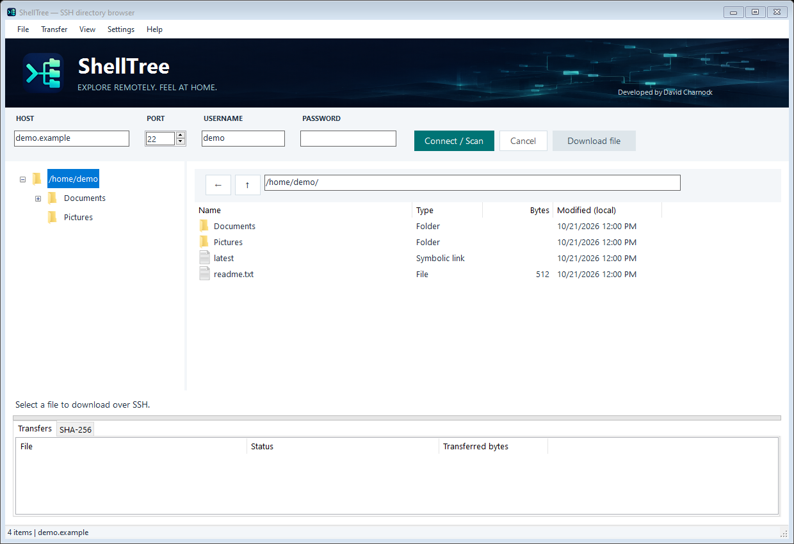

# ShellTree v0.30

## Updating listings and managing remote items

Successful uploads automatically refresh the affected directory in memory; JSON is written only when you choose **File → Save JSON As**. No full rescan is needed. Completed files remain visible if a later file in the batch fails.

In the file list, right-click one file or folder and choose **Copy**, **Cut**, **Paste into current folder**, or **Delete**. Copy duplicates it on the same remote server; Cut followed by Paste moves it. Open the destination folder before pasting. Existing destinations are not overwritten. The internal clipboard is restricted to the same host, port, and account.

Delete requires a confirmation showing the server and full path, and permanently removes the selected item including a folder's contents. It does not use the Windows Recycle Bin. Remote copy/move/delete require GNU-compatible `cp`, `mv`, and `rm`. Listing updates are saved after operations. A cancellation or failure can leave some changes completed; refresh the affected folders if necessary.

## Current interface and uploads

**Settings → Scan settings** contains the root folder and scan depth. Host, port, username, password, Connect / Scan, Cancel, and Download file share one row. **View → Transfers pane** shows or hides the bottom Transfers and SHA-256 tabs. Folder and file-type icons come from Windows.

Drop local files or folders onto the remote file list to upload them into the folder currently shown in the path bar. Alternatively use **Transfer → Upload files to current folder** or **Upload folder to current folder**. Nested and empty directories are included. Local links and junctions are rejected. Existing remote files are never overwritten; an existing directory can receive new files. Rescan after an upload to refresh the cached listing. If a batch fails, previously completed files remain uploaded.

Uploads stream to remote `cat`, using an exclusively created temporary file in the destination directory. With SHA-256 enabled, the remote temporary file hash is compared against the local source hash before publishing. The remote server needs `sh`, `cat`, `mkdir`, `mv`, `rm`, and (when checking is enabled) `sha256sum`. `mktemp` is no longer required. The SSH account must have write and traversal permissions on the destination directory; a read-only filesystem cannot accept uploads. Downloads and uploads use SSH commands, never SCP or SFTP.

Drop desktop files onto the file list, tree, or path box to upload to the displayed folder. The status bar shows the destination or a reason the drop is unavailable. Run ShellTree at the same privilege level as Explorer.

Outbound dragging uses the visible window's OLE drag loop and continues pumping UI messages while awaiting SSH. One batch runs at a time. Keep ShellTree open while Explorer copies the staged downloads; the final Explorer destination is not rehashed.

## SHA-256 transfer verification

Use **Transfer → Verify transfers with SHA-256** to turn automatic checking on or off. It is on by default and the preference is saved. The toggle is locked during a transfer so a folder uses one consistent setting. This replaces the single-file CRC command; SHA-256 is a cryptographic hash, not CRC.

With checking enabled, each regular file is streamed over SSH using `cat`, then the remote `sha256sum` result is compared with a SHA-256 calculated from the downloaded local bytes. Only a match allows the temporary download to replace its destination. Mismatches, missing `sha256sum`, or other verification failures fail the transfer and preserve any existing destination file. The remote file must remain unchanged during transfer and checking.

The bottom **Transfers** tab shows file status and downloaded bytes. The **SHA-256** tab shows the remote and local hashes and whether they match. With verification off, rows explicitly show Disabled. Back and Up sit beside the path above the file list, matching FetchTree.

For drag-and-drop, verification covers the staged local file handed to Windows Explorer. Explorer controls the final desktop/folder copy; ShellTree does not re-read that final destination. Staging files remain in the documented DragCache directory until manually removed after copying.

Developed by David Charnock.

A Windows desktop browser for Linux directories over SSH, inspired by [FetchTree](https://github.com/duke2k1/FetchTree).

## Run

Extract the complete Windows package and launch **ShellTree.exe**. Keep the included DLLs, configuration file and notices beside it. Requires Windows 10/11 and .NET Framework 4.8. SSH is integrated using SSH.NET; no OpenSSH installation or terminal is required.

Enter **Host**, **Port**, **Username**, and **Password**, choose an absolute Linux root path and scan depth, then click **Connect / Scan**. The password field is masked. The server must permit SSH password authentication. Private-key authentication, keyboard-interactive authentication and MFA are not included in v0.2.

On first connection, ShellTree displays the server's SHA-256 fingerprint. Verify it with the server administrator before trusting it. Trusted keys are saved under `%LOCALAPPDATA%\ShellTree\trusted-hosts.json`. Changed keys are blocked. This trust store is independent of OpenSSH's known_hosts file.

Passwords remain in memory while the app is open; they are never written to snapshots, settings, command-line arguments, or logs. Changing the host or username, opening a saved listing, or closing the app clears the password field. No SSH credentials are required to browse a saved listing.

## Browse

Use the folder tree or double-click folders in the details view. **Back** and **Up** provide familiar navigation.

JSON controls are under **File → Open JSON** and **File → Save JSON As** in the top menu. They do not appear on the main connection/navigation panel. **Help → SSH connection help** explains connection requirements.

Depth 0 lists the root and its immediate children. Higher depths preload more levels. Folders beyond the scan depth display **Not scanned** instead of appearing empty. To browse deeper, enter that folder's absolute path as Root and scan again.

## Scanning and storage

ShellTree uses SSH command execution with `sh`, `cd` and GNU `find -printf`. It does not use SCP, FTP, SFTP, or a remote agent. Names and metadata are NUL-separated to preserve spaces, quotes, tabs and newlines. Filenames must be valid UTF-8. Symlinks are listed but never followed, and file contents are neither transferred nor executed.

Successful scans are saved atomically to `%LOCALAPPDATA%\ShellTree\last.snapshot.json`; the GUI then reads this file. It reopens the last listing on startup. Failed, cancelled, permission-denied or truncated scans preserve the previous listing. Snapshots include host, username, file paths, sizes and timestamps, but no passwords.

The server requires GNU find with `-printf`; BusyBox/BSD variants without that option are unsupported. Limits: depth 0–20, 100,000 entries, 32 MB listing/JSON, 64 KB diagnostics, 15-second connection timeout and two-minute command timeout. A scan is a point-in-time approximation; remote files can change while it runs.

## Build and test

```powershell
./build.ps1 -Test
./bin/ShellTree.exe
```

The build restores pinned NuGet packages and verifies their SHA-256 hashes from `dependencies.lock.json`. Internet access is required on the first build. Optional `-NodePath <node.exe>` selects Node's HTTPS downloader when needed.

The automated suite checks parsing, path integrity, shell quoting, JSON preservation, output limits, password exclusion and host-key trust. Optional SSH integration tests use a loopback-only fixture with synthetic credentials:

```powershell
python -m pip install -r tests/requirements.txt
./tests/integration.ps1
```

The fixture checks password success/failure, unknown-host rejection, Unicode output, remote errors, truncated output and cancellation. It uses SSH command execution and does not serve SFTP. A separate optional test runs the scanner script with real GNU find from Git for Windows. Testing against your own Linux server is still recommended.

## JSON format

Version 1 remains compatible with v0.1 snapshots. Connection metadata, `Root`, `Depth` and `ScannedUtc` accompany `Entries`, each with relative `Path`, Linux `Kind`, byte `Size` and `ModifiedUnix`. See [examples/demo.json](examples/demo.json).

## Dependencies and scope

See [THIRD-PARTY-NOTICES.md](THIRD-PARTY-NOTICES.md) and the included notice archive for bundled library licenses.

File downloads, uploads, drag-to-Explorer transfers, on-demand live expansion and an installer are not implemented. v0.2 focuses on built-in password-based SSH, bounded directory scans and cached navigation.

## Drag files and folders to Windows

Drag a file or folder from the details list or folder tree onto the desktop or Windows Explorer. Windows requests the transfer data during the drag; keep ShellTree open while the contents are prepared. Large folders take time to download. Cancel stops preparation.

Folder transfers read each directory afresh, independently of the browse depth, and stream regular files using cat over SSH. Unreadable folders, links, special files, names Windows cannot represent, and case-insensitive name collisions stop the transfer with an error rather than silently produce an incomplete copy.

Staged copies remain in %LOCALAPPDATA%\ShellTree\DragCache so Explorer can finish copying after the drag returns. You can remove this cache manually after your transfers finish. Closing ShellTree hides the window immediately and requests cancellation without requiring another click.

The drag repair was checked with 44 automated checks, including Windows CF_HDROP retrieval, nested-folder staging, unsafe-name rejection, and closing during an active operation. A live drag to your desktop still needs confirmation on your system.
